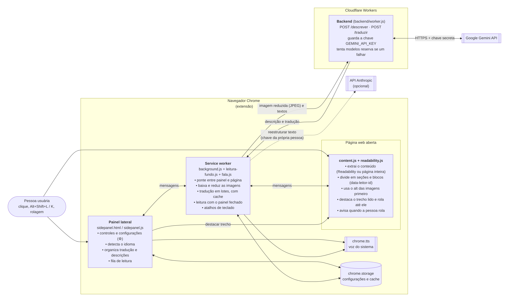
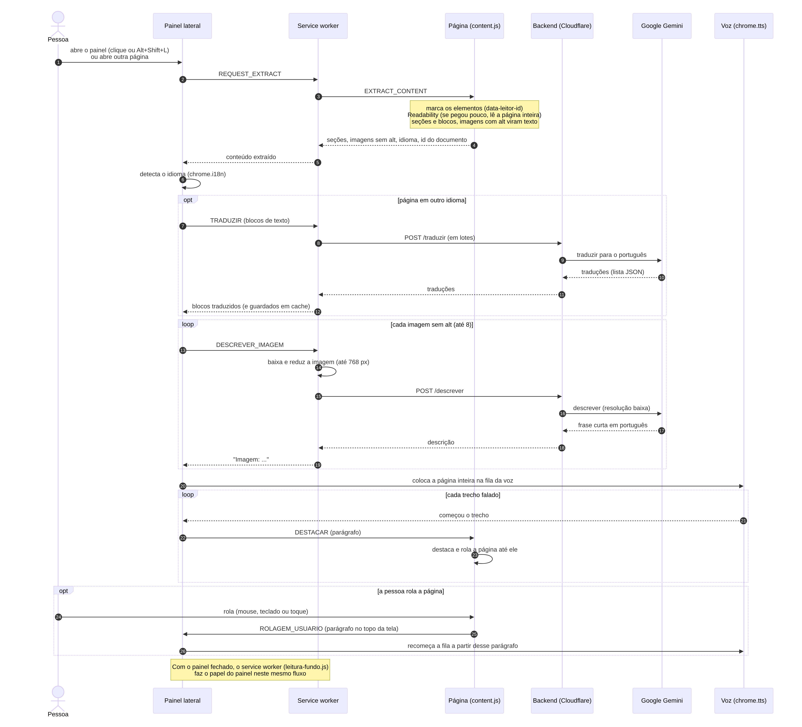

# 🔊 Leitor Acessível com IA

> Extensão para o Google Chrome que lê qualquer página da web em voz alta,
> descreve com IA as imagens sem texto alternativo e traduz páginas em
> outro idioma para o português.

[](https://github.com/Hiago-Mantas/AI-accessibility-project/archive/refs/heads/main.zip)

<sub>Baixa a versão mais recente do branch `main` (extensão + backend). Veja [Como instalar](#-como-instalar).</sub>

Projeto individual da disciplina **Projetos (Engenharia de Software)**.

## 📑 Sumário

- [Problema](#-problema)
- [Solução](#-solução)
- [Público-alvo e impacto social](#-público-alvo-e-impacto-social)
- [Funcionalidades](#-funcionalidades)
- [Arquitetura e funcionamento](#-arquitetura-e-funcionamento)
- [Tecnologias](#-tecnologias)
- [Como instalar](#-como-instalar)
- [Como usar](#-como-usar)
- [Configurações](#-configurações)
- [Estrutura do repositório](#-estrutura-do-repositório)
- [Gestão do projeto no GitHub](#-gestão-do-projeto-no-github)
- [Privacidade e segurança](#-privacidade-e-segurança)
- [Limitações conhecidas e próximos passos](#-limitações-conhecidas-e-próximos-passos)
- [Status](#-status)
- [Equipe](#-equipe)
- [Referências](#-referências)

## 🎯 Problema

Pessoas cegas, com baixa visão ou com dificuldade de leitura dependem de
leitores de tela, mas grande parte da web não foi feita pensando nelas:

- **Páginas mal estruturadas:** muitos sites não usam títulos e marcações
  corretas, e o leitor de tela lê menus, banners e avisos misturados com o
  conteúdo principal.
- **Imagens sem texto alternativo (`alt`):** fotos, gráficos e cartazes sem
  descrição viram apenas "imagem" para quem não enxerga, e a informação se
  perde.
- **Páginas em outro idioma:** um conteúdo em inglês lido por uma voz em
  português fica incompreensível, e quem não conhece o idioma fica de fora.
- **Ferramentas pagas ou complexas:** soluções completas costumam exigir
  instalação, configuração ou assinatura.

## 💡 Solução

Uma extensão gratuita para o Chrome que, com um clique ou um atalho:

1. **Extrai o conteúdo principal** da página (com o Readability.js, o mesmo
   mecanismo do "Modo leitura" do Firefox), descartando menus, rodapés e
   anúncios, e divide o texto em seções navegáveis.
2. **Lê em voz alta**, seção por seção, sem pausas, com controles por
   teclado.
3. **Usa o `alt` das imagens primeiro** e só pede à IA (Google Gemini) a
   descrição das imagens que não têm texto alternativo.
4. **Traduz para o português** páginas em outro idioma antes de ler.
5. **Acompanha a leitura na tela:** o trecho lido fica destacado e a página
   rola junto; se a pessoa rolar a página, a leitura pula para o que está
   na tela.

A chave da IA fica num backend próprio (Cloudflare Workers), nunca dentro
da extensão: qualquer pessoa pode baixar e usar sem configurar nada.

## 🤝 Público-alvo e impacto social

- **Pessoas cegas ou com baixa visão**, que ganham acesso à informação das
  imagens sem alt e a uma leitura limpa do conteúdo principal.
- **Pessoas com dislexia, TDAH ou baixa escolaridade**, que acompanham o
  texto ouvindo e vendo o trecho destacado.
- **Idosos** e pessoas com pouca familiaridade com tecnologia: a leitura
  começa sozinha ao abrir o painel.
- **Quem não lê em outros idiomas**, que passa a ouvir em português sites
  em inglês, espanhol e outros.

Segundo o IBGE, o Brasil tem 14,4 milhões de pessoas com deficiência, e a
mais frequente é a dificuldade para enxergar, mesmo com óculos: cerca de
7,9 milhões de pessoas (Censo 2022, resultados preliminares). A ferramenta
é gratuita, de código aberto e funciona em qualquer site, sem depender de
o site ter sido feito de forma acessível.

## ✨ Funcionalidades

| Funcionalidade | Descrição |
|---|---|
| 📄 Extração do conteúdo | Readability.js; em páginas iniciais de empresas e portais (vários blocos curtos), lê o conteúdo principal inteiro quando o Readability pega só uma parte |
| 🗂️ Seções navegáveis | O texto é dividido pelos títulos da página; navegação por botões, lista ou setas do teclado |
| 🔊 Leitura sem pausas | A página inteira entra na fila da voz do sistema (`chrome.tts`) |
| 🖼️ Descrição de imagens | `alt` primeiro; imagens sem alt são descritas pelo Gemini (até 8 por página), ícones e imagens decorativas são ignorados; funciona com SVG, galerias e carrosséis |
| 🌎 Tradução | Detecta o idioma pelo próprio texto e traduz para o português; sem tradução, lê com uma voz do idioma original |
| ▶️ Leitura automática | Ao abrir o painel e a cada página aberta, a leitura começa sozinha |
| 🙈 Leitura com o painel fechado | Lê as páginas mesmo sem abrir o painel, desde a abertura do navegador |
| 🖍️ Página e áudio juntos | O parágrafo lido fica destacado e a página rola até ele; rolar a página leva a leitura para o que está na tela |
| ⌨️ Atalhos | Alt+Shift+L abre o painel, Alt+Shift+K pausa/continua de qualquer lugar |
| ✍️ Reestruturação por IA (opcional) | Com uma chave da Anthropic, o texto de cada seção é reescrito em frases mais claras |
| 📁 Arquivos locais | Lê arquivos `.html` abertos do computador (`file:///`) |

## 🧩 Arquitetura e funcionamento

O projeto tem duas partes: a **extensão** (roda no navegador da pessoa) e o
**backend** (roda na Cloudflare e guarda a chave do Gemini).

### Diagrama 1: Arquitetura (componentes)

As partes do sistema e como elas se comunicam.

[](docs/diagramas/arquitetura.png)

<sub>Clique na imagem para ver em tamanho real.</sub>

| Componente | Arquivos | Papel |
|---|---|---|
| Script da página | `content.js`, `readability.js` | Único que enxerga o HTML: extrai o texto, liga cada trecho ao elemento da página, destaca e rola, avisa quando a pessoa rola |
| Painel lateral | `sidepanel.html`, `sidepanel.js`, `sidepanel.css` | Interface (botões, seções, ⚙); com o painel aberto, organiza a leitura |
| Service worker | `background.js`, `leitura-fundo.js`, `fala.js` | Ponte entre painel e página, baixa e reduz imagens, tradução em lotes com cache, leitura com o painel fechado, atalhos |
| Backend | `backend/worker.js` | Rotas `POST /descrever` e `POST /traduzir`; guarda a chave do Gemini; tenta modelos reserva se um falhar |

### Diagrama 2: Sequência de uma leitura

O passo a passo de uma página em inglês com uma imagem sem `alt`, do
clique até a voz.

[](docs/diagramas/sequencia.png)

<sub>Clique na imagem para ver em tamanho real.</sub>

Pontos principais do fluxo:

1. **Alt primeiro:** imagens com texto alternativo viram texto na própria
   página e não gastam IA.
2. **Economia de tokens:** tradução em lotes e com cache; imagens reduzidas
   (até 768 px) e enviadas em resolução baixa; no máximo 8 imagens por página.
3. **Falhas não travam a leitura:** sem tradução, a página é lida no idioma
   original; sem descrição, a leitura avisa "Imagem sem descrição".

O código dos diagramas (Mermaid) e mais detalhes estão em
[docs/diagramas.md](docs/diagramas.md).

## 🧰 Tecnologias

| Camada | Tecnologia |
|---|---|
| Extensão | JavaScript, HTML e CSS, Chrome Extensions **Manifest V3** (painel lateral, service worker, content scripts) |
| Extração de conteúdo | [Readability.js](https://github.com/mozilla/readability) (Mozilla) |
| Voz | `chrome.tts` (vozes do sistema operacional) |
| Idioma | `chrome.i18n.detectLanguage` (detecção sem internet) |
| Armazenamento | `chrome.storage` (configurações e cache da sessão), sem banco de dados |
| Backend | [Cloudflare Workers](https://workers.cloudflare.com/) (JavaScript, plano gratuito) |
| IA | [Google Gemini API](https://ai.google.dev/) (`gemini-3.5-flash-lite`, com modelos reserva) |
| IA opcional | API da Anthropic (reestruturação do texto, com a chave da própria pessoa) |
| Ferramentas | Git e GitHub, Wrangler (deploy do backend), Playwright + Chromium (testes automatizados durante o desenvolvimento) |

## 📥 Como instalar

Não é preciso terminal nem chave de API: a extensão já usa o backend
publicado.

1. Clique no botão **Baixar** no topo desta página e descompacte o arquivo.
   Vai aparecer a pasta `AI-accessibility-project-main`.
2. No Chrome, abra `chrome://extensions` (no Edge, `edge://extensions`).
3. Ligue o **Modo do desenvolvedor** (canto superior direito).
4. Clique em **Carregar sem compactação** e escolha a pasta
   `AI-accessibility-project-main`.
5. Abra qualquer página e clique no ícone da extensão (ou use
   **Alt+Shift+L**).

Para rodar ou publicar o seu próprio backend, veja
[backend/README.md](backend/README.md).

## 🎧 Como usar

1. Abra o painel pelo ícone da extensão ou com **Alt+Shift+L**: a página
   atual começa a ser lida sozinha.
2. Navegue normalmente: cada página aberta (ou aba trocada) é lida
   automaticamente, e a voz para quando você sai da página.
3. Acompanhe na tela: o parágrafo lido fica destacado com um contorno
   laranja e a página rola junto.
4. Role a página para pular a leitura para outro ponto.

### Atalhos de teclado

| Atalho | Onde | Ação |
|---|---|---|
| **Alt+Shift+L** | Qualquer lugar | Abre o painel e começa a ler |
| **Alt+Shift+K** | Qualquer lugar | Pausa ou continua a leitura |
| **Espaço** | No painel | Reproduz ou pausa |
| **← / →** | No painel | Seção anterior / próxima |

Os atalhos globais podem ser trocados em `chrome://extensions/shortcuts`.

No painel também há a lista de seções (clique para pular), o controle de
velocidade da voz e o botão **"↻ Ler a página de novo"**, que extrai a
página outra vez e descarta as descrições e traduções guardadas.

## 🔧 Configurações

No ícone de engrenagem (⚙) do painel:

| Opção | Padrão | O que faz |
|---|---|---|
| Chave de API da Anthropic | vazia | Opcional: reescreve o texto de cada seção em frases mais claras |
| Descrever imagens sem texto alternativo | ligada | Envia ao Gemini só as imagens sem `alt` |
| Descrições detalhadas | desligada | Até 2 frases em vez de uma frase curta |
| Traduzir páginas em outro idioma | ligada | Traduz para o português antes de ler |
| Ler também com o painel fechado | ligada | Lê as páginas sem precisar abrir o painel |
| Ler automaticamente | ligada | Começa a ler sozinho a cada página aberta |

> 💡 Quem usa um leitor de tela (como o NVDA) pode preferir desligar a
> leitura automática e a leitura com o painel fechado, para as duas vozes
> não falarem juntas.

### Arquivos `.html` do computador

O Chrome só deixa extensões lerem arquivos locais (`file:///`) com
permissão: em `chrome://extensions`, clique em **Detalhes** no Leitor
Acessível e ligue **"Permitir acesso a URLs de arquivo"**. Se a permissão
estiver desligada, o painel explica como ligá-la.

## 📂 Estrutura do repositório

```
AI-accessibility-project/
├── manifest.json        # Configuração da extensão (Manifest V3, permissões, atalhos)
├── config.js            # Endereço do backend publicado
├── content.js           # Roda na página: extração, destaque, rolagem
├── readability.js       # Biblioteca da Mozilla para achar o conteúdo principal
├── background.js        # Service worker: ponte, imagens, tradução, atalhos
├── leitura-fundo.js     # Leitura com o painel fechado
├── fala.js              # Divisão do texto em trechos para a voz
├── sidepanel.html/.css/.js  # Painel lateral (interface)
├── icons/               # Ícones da extensão
├── backend/             # Servidor na Cloudflare (Gemini)
│   ├── worker.js
│   ├── wrangler.toml
│   └── README.md
└── docs/
    ├── diagramas.md     # Diagramas em Mermaid, com explicação
    └── diagramas/       # Diagramas em PNG (slides e documento)
```

## 📋 Gestão do projeto no GitHub

- **Branches:** `main` (versão estável, a do botão de download), `develop`
  (integração) e um branch por tarefa: `feature/*` (funcionalidades),
  `bugfix/*` (correções) e `docs/*` (documentação).
- **Pull Requests:** toda mudança entra no `develop` por PR, com descrição
  e tabela de testes; o `develop` é levado para a `main` quando está estável.
- **Commits:** padrão [Conventional Commits](https://www.conventionalcommits.org/pt-br/)
  (`feat:`, `fix:`, `docs:`), em português.
- **Issues:** cada bug e funcionalidade tem uma Issue, fechada pelo PR que a
  resolve (veja as [Issues](https://github.com/Hiago-Mantas/AI-accessibility-project/issues?q=is%3Aissue)
  e os [Pull Requests](https://github.com/Hiago-Mantas/AI-accessibility-project/pulls?q=is%3Apr)).

## 🔒 Privacidade e segurança

- A chave do Gemini fica só no backend, como segredo da Cloudflare; nunca
  vai para a extensão nem para o repositório.
- Só vão para o backend e para o Google Gemini: as **imagens sem alt** e o
  **texto de páginas em outro idioma**. Páginas em português e imagens com
  alt não saem do navegador.
- No plano gratuito do Gemini, o Google pode usar o conteúdo enviado para
  melhorar os produtos dele; a extensão avisa isso nas configurações, e as
  duas funções podem ser desligadas.
- A chave opcional da Anthropic fica salva só no navegador da pessoa
  (`chrome.storage.local`).

## 🚧 Limitações conhecidas e próximos passos

**Limitações**

- O Chrome não deixa extensões abrirem o painel lateral sozinhas (só depois
  de um clique ou atalho); por isso, ao abrir o navegador, quem lê é a
  leitura com o painel fechado.
- A voz depende das vozes instaladas no sistema operacional (no Windows em
  português, a "Maria"); para ler uma página sem tradução em outro idioma,
  é preciso ter uma voz desse idioma.
- A divisão em seções segue os títulos da página; páginas sem nenhum título
  viram um único bloco.
- A cota gratuita do Gemini é limitada; quando acaba, a leitura avisa que a
  imagem ficou sem descrição.
- Com o painel fechado, imagens SVG ficam sem descrição.

**Próximos passos**

- Testes com pessoas usuárias de leitores de tela (NVDA) e ajustes a partir
  deles.
- Limite de pedidos por pessoa no backend.
- Publicação na Chrome Web Store, para instalar sem o modo do desenvolvedor.

## 📊 Status

🟢 **Funcional:** todas as funcionalidades acima estão implementadas e no
branch `main`. Em fase de documentação final e preparação da apresentação.

## 👤 Equipe

Projeto individual.

- **Hiago Mantas** ([@Hiago-Mantas](https://github.com/Hiago-Mantas)):
  análise, desenvolvimento da extensão e do backend, testes e documentação.

## 📚 Referências

1. SOMMERVILLE, Ian. **Engenharia de Software**. 10ª ed. São Paulo: Pearson, 2018.
2. W3C. [Web Content Accessibility Guidelines (WCAG) 2.1](https://www.w3.org/TR/WCAG21/). 2018.
3. W3C. [Images Tutorial: textos alternativos](https://www.w3.org/WAI/tutorials/images/).
4. BRASIL. [Lei nº 13.146/2015: Lei Brasileira de Inclusão da Pessoa com Deficiência](https://www.planalto.gov.br/ccivil_03/_ato2015-2018/2015/lei/l13146.htm).
5. IBGE. [Censo 2022: Brasil tem 14,4 milhões de pessoas com deficiência](https://agenciadenoticias.ibge.gov.br/agencia-noticias/2012-agencia-de-noticias/noticias/43463-censo-2022-brasil-tem-14-4-milhoes-de-pessoas-com-deficiencia). Agência de Notícias IBGE, 2025.
6. MOZILLA. [Readability.js](https://github.com/mozilla/readability).
7. GOOGLE. [Chrome Extensions: documentação (Manifest V3)](https://developer.chrome.com/docs/extensions).
8. GOOGLE. [Gemini API: documentação](https://ai.google.dev/gemini-api/docs).
9. CLOUDFLARE. [Workers: documentação](https://developers.cloudflare.com/workers/).
