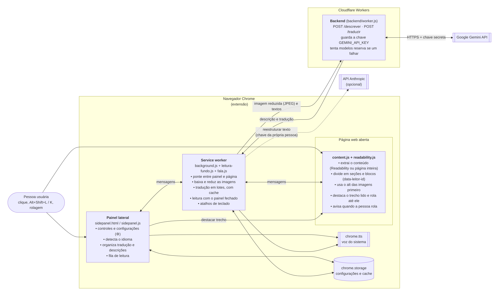
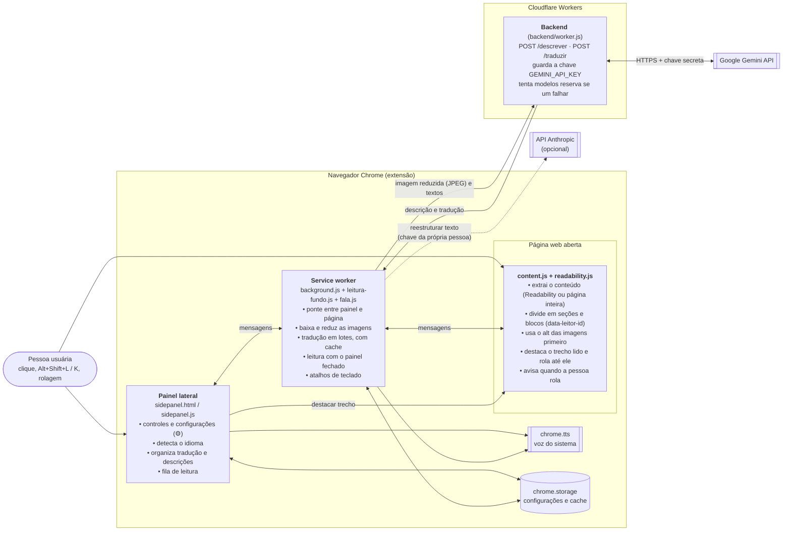
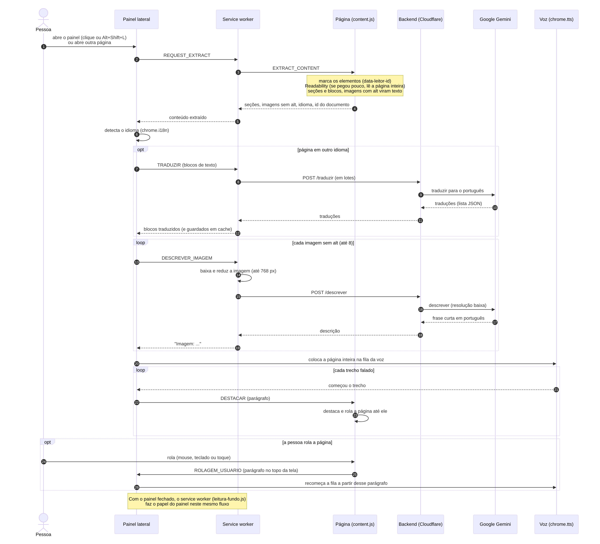
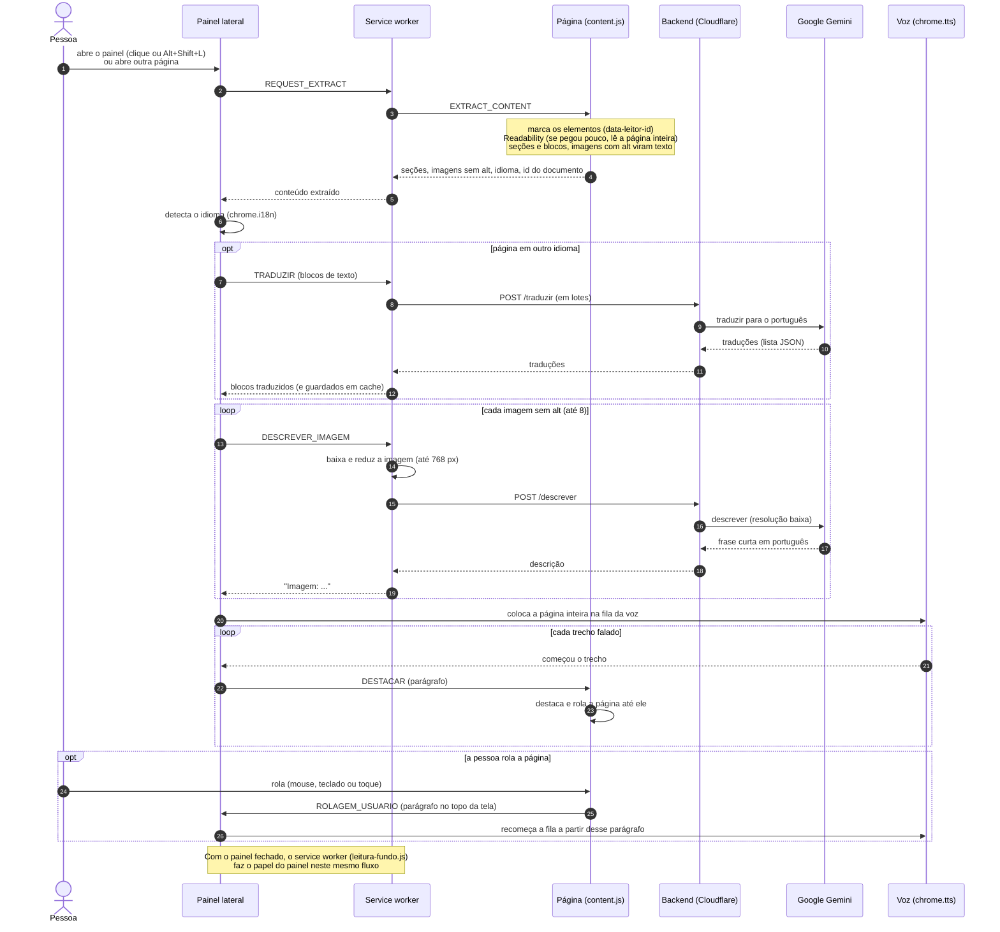

# Como o Leitor Acessível funciona

Dois diagramas: o primeiro mostra **as partes do sistema** e como elas se
comunicam; o segundo mostra **o passo a passo de uma leitura**, do clique
até a voz.

As imagens (PNG) para slides e documento ficam em [`docs/diagramas/`](diagramas/).

## 1. Arquitetura (componentes)

Código do diagrama (Mermaid)

**Leitura do diagrama:**

- **content.js** roda dentro de cada página: é o único que enxerga o HTML.
  Extrai o texto, liga cada trecho ao elemento da página (`data-leitor-id`)
  e cuida do destaque e da rolagem.
- **Painel lateral** é a interface (botões, lista de seções, ⚙). Com ele
  aberto, é ele quem organiza a leitura.
- **Service worker** fica sempre ativo em segundo plano: faz a ponte com a
  página, baixa as imagens, conversa com o backend e, **com o painel
  fechado**, faz a leitura sozinho (`leitura-fundo.js`).
- **chrome.tts** é a voz do sistema operacional, usada porque pode falar
  sem clique (necessário para a leitura automática).
- **Backend na Cloudflare** guarda a chave do Gemini, que nunca vai para a
  extensão. Só recebe imagens sem alt e textos para traduzir.
- **API Anthropic** é opcional: só é usada se a pessoa colar a própria
  chave no ⚙, para reestruturar o texto.

## 2. Sequência de uma leitura

Exemplo: uma página em inglês com uma imagem sem texto alternativo, lida
com o painel aberto.

Código do diagrama (Mermaid)

**Pontos importantes do fluxo:**

1. **Alt primeiro:** imagens que já têm texto alternativo viram texto na
   própria página (passo 4) e não gastam IA. Só as sem alt vão ao Gemini.
2. **Economia:** a tradução vai em lotes e fica em cache; a imagem é
   reduzida e enviada em resolução baixa; no máximo 8 imagens por página.
3. **Sem pausas:** a página inteira entra de uma vez na fila da voz, que
   emenda um trecho no outro.
4. **Página e áudio juntos:** cada trecho falado destaca o parágrafo na
   página; rolar a página faz a leitura pular para o que está na tela.
5. **Falhas não travam a leitura:** sem tradução a página é lida no idioma
   original; sem descrição a leitura avisa "Imagem sem descrição".
